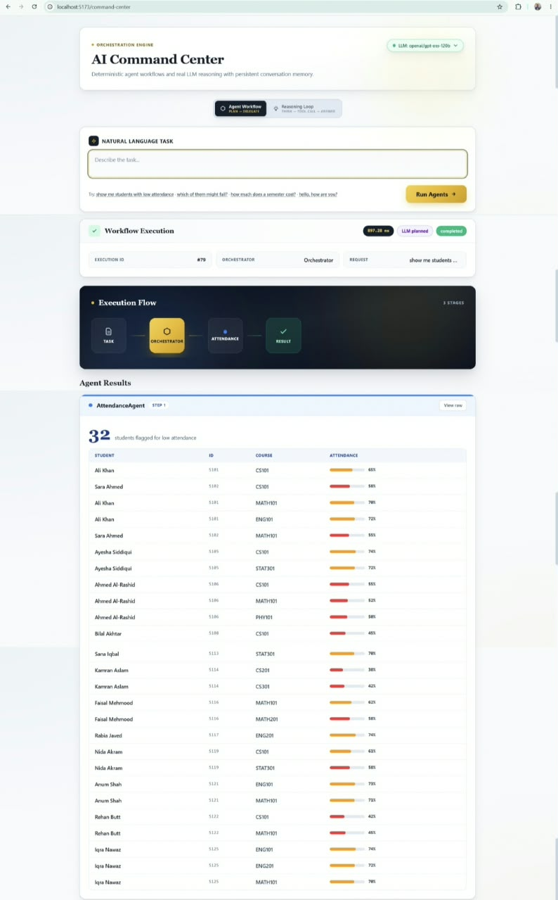
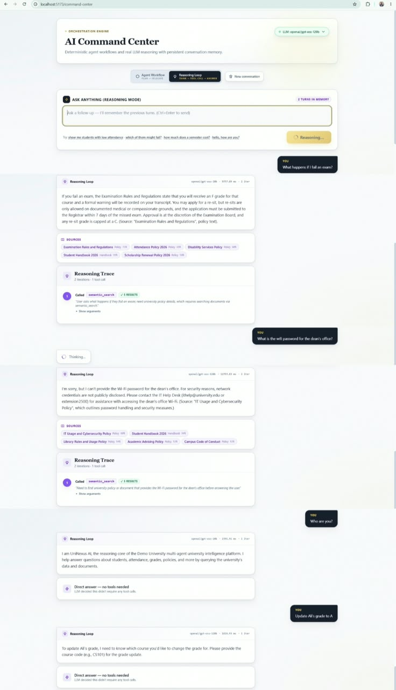
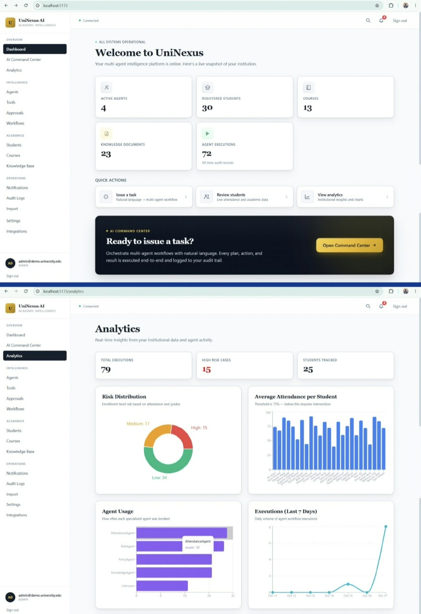
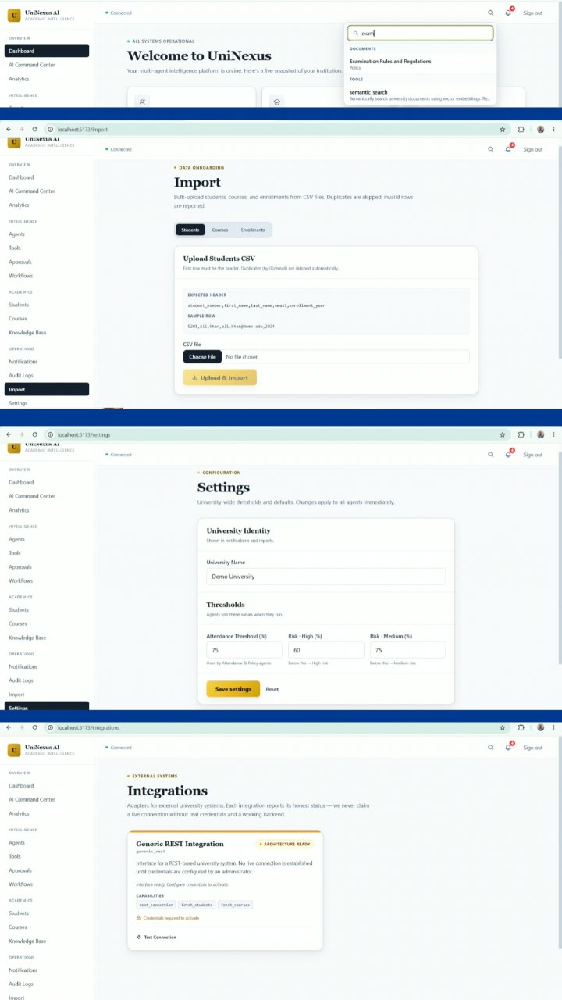
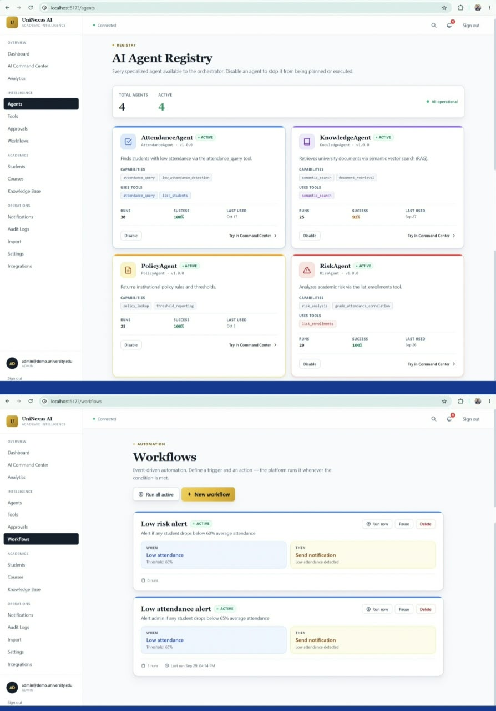
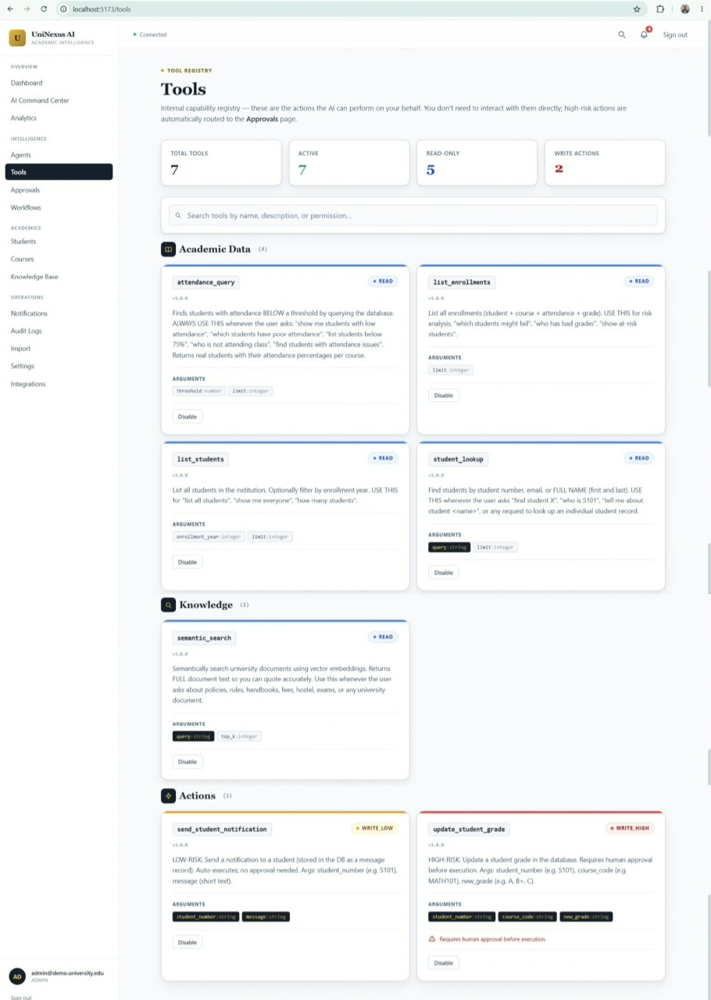
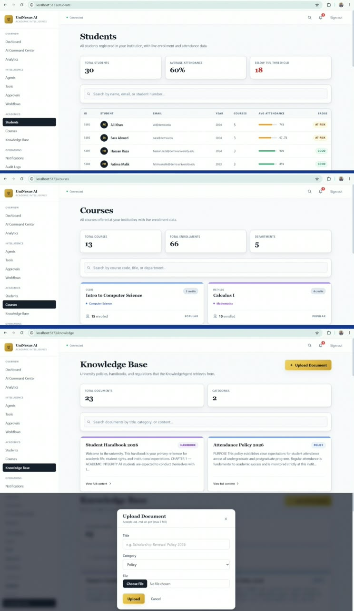
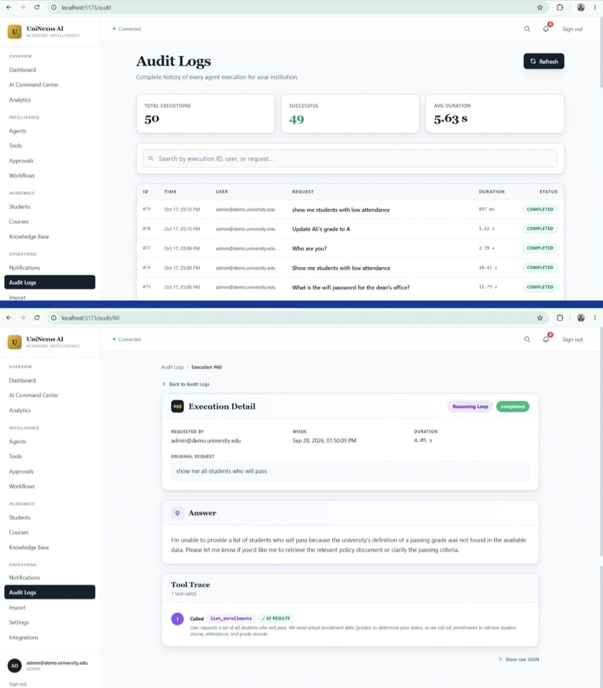
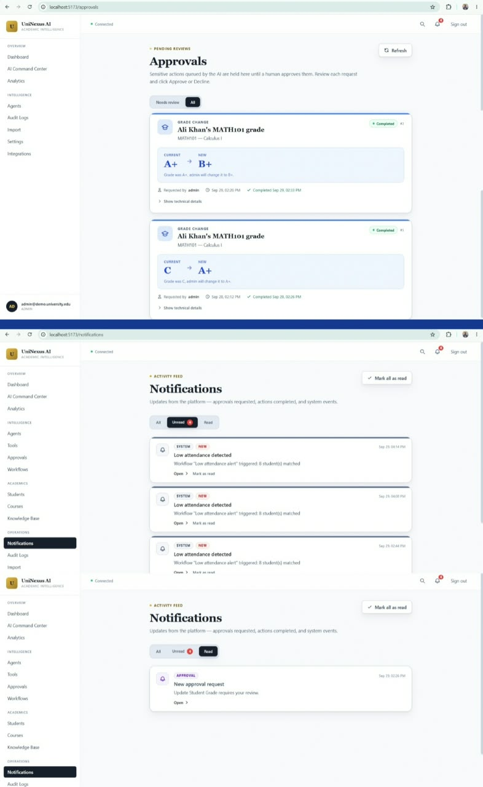

# UniNexus AI

**Autonomous Multi-Agent University Intelligence Platform**

Built by **ZARAK KHAN** — a portfolio project exploring agentic AI, tool calling, RAG, human-in-the-loop controls, and workflow automation for university operations.

[](https://www.python.org/)
[](https://fastapi.tiangolo.com/)
[](https://react.dev/)
[](tests/)
[](LICENSE)

---

## Overview

UniNexus AI is a modular university intelligence platform built around a **reasoning loop, registered tools, specialized agents, retrieval, approvals, and workflow automation**.

Instead of treating an LLM as a standalone chatbot, UniNexus AI gives the model controlled access to university data and actions. A request can be planned, executed through tools, checked through the reasoning loop, and returned with an execution trace. Higher-risk write actions can be held for human approval before execution.

> **Portfolio / educational project:** UniNexus AI uses seeded demo university data and is not presented as production software or a real university integration.

---

## Core Capabilities

### Agentic Reasoning
- Multi-step reasoning loop with a configurable maximum of 5 iterations
- Tool selection and execution based on structured model actions
- Multi-turn conversation history with session persistence
- Structured execution traces containing iterations, tools, arguments, and results
- Deterministic planning fallback when an LLM provider is unavailable

### Access Control & Observability
- Role-based access control (Super Admin / University Admin / Faculty / Student)
- Role-aware sidebar, route guards, and Access Denied page
- Backend-enforced data scoping (students see only their own record)
- Multi-tenant isolation verified by 8 automated tests
- Execution detail view with full plan, tool trace, and answer drill-down
- Per-execution duration, status, and reasoning-vs-workflow type detection
### Tool System
- Central tool registry for controlled execution
- Permission levels for read and write operations
- Academic data tools for students, attendance, enrollments, and grades
- Semantic document search
- Student notification action
- Grade-update action protected by human approval


### Safety & Reliability
- Prompt-injection scanning (prompt / SQL / command patterns)
- Hallucination guard: rejects source-citing answers when no evidence was collected
- Evidence-quality classification for RAG (strong / weak / none)
- Per-user in-memory rate limiter on reasoning and workflow endpoints
- Multi-tenant isolation enforced and verified by 8 automated tests
### Human-in-the-Loop
- High-risk actions are intercepted before execution
- Admin approval queue with Approve / Decline actions
- Approval state persisted in the database
- Notifications and audit records connected to approval flows

### Retrieval-Augmented Knowledge
- Local embeddings through Ollama's `nomic-embed-text`
- Persistent lightweight vector store using NumPy + pickle
- Cosine-similarity retrieval
- Seeded university policy and academic documents

### Data Management
- CSV import for students, courses, and enrollments (admin-only, validation, duplicate handling)
- Document upload for the knowledge base (PDF / TXT / MD)
- Auto-chunking and embedding on upload
- Duplicate title rejection per tenant
### Event Architecture
- Lightweight in-process pub/sub event bus
- Real-time event history API for administrators
- Auto-triggering workflows based on system events (e.g., DocumentUploaded)

### Integrations Architecture
- Honest integration interface (no fake connections)
- Pluggable adapters (Generic REST architecture-ready)
- Admin UI to view integration status and test connections

### Error Handling
- Consistent JSON error envelope across the entire API
- Proper validation error mapping (422)
- Graceful 500 fallback without exposing stack traces

### Workflow Automation
- Trigger → condition → action workflow model
- Manual run controls
- Pause/resume support
- Friendly execution results
- Notifications connected to workflow activity

### University Operations UI
- Dashboard
- AI Command Center
- Agent Registry
- Tools Registry
- Students
- Courses
- Knowledge Base
- Approvals
- Notifications
- Analytics
- Audit Logs
- Workflows

---

## What Makes UniNexus AI Different?

The project focuses on the **system around the model**, not only the model call.

| Capability | UniNexus AI |
|---|---|
| LLM interaction | Structured reasoning loop with tool calls |
| Data grounding | Answers can be based on executed tool/retrieval results |
| Tools | Central registry with permission levels |
| Safety | High-risk writes can require human approval |
| Memory | Multi-turn conversation history |
| RAG | Local embeddings + cosine-similarity vector retrieval |
| LLM providers | Groq, Gemini, and Ollama through one gateway |
| Automation | Persistent workflows and notifications |
| Observability | Execution history, approvals, and audit records |

---


---

## 📸 Project Showcase

### 🧠 AI Command Center & Reasoning
*Real agentic reasoning with multi-turn memory, tool-calling, and the anti-hallucination guard in action.*

**Agent Workflow Execution:**


**Multi-turn Reasoning & Hallucination Guard:**


### 📊 Dashboards & Institutional Analytics
*Live snapshots of the multi-agent platform, tracking executions, risk distribution, and agent usage.*




### 🤖 Multi-Agent Platform Architecture
*DB-driven agents and tools with live health stats, permission levels, and event-driven workflows.*




### 📚 Data Management & RAG
*CSV imports, document uploads with auto-chunking, and vector-based semantic search.*



### 🔒 Security & Observability
*Full audit trails, human-in-the-loop approvals for WRITE_HIGH actions, and system notifications.*

**Audit Logs & Execution Trace:**


**Approvals & Notifications:**


---

## Architecture

```text
┌─────────────────────────────────────────────────────────────┐
│                       React Frontend                        │
│ Dashboard • Command Center • Agents • Tools • Workflows    │
│ Approvals • Knowledge • Analytics • Notifications • Audit  │
└──────────────────────────────┬──────────────────────────────┘
                               │ REST / JWT
                               â–¼
┌─────────────────────────────────────────────────────────────┐
│                       FastAPI Backend                       │
│                                                             │
│  API Routes                                                 │
│      │                                                      │
│      ├── Reasoning Loop ──► LLM Gateway                    │
│      │                         ├── Groq                     │
│      │                         ├── Gemini                   │
│      │                         └── Ollama                   │
│      │                                                      │
│      ├── Tool Registry ──► Academic / Knowledge / Write    │
│      │                         │                            │
│      │                         └── Approval Gate            │
│      │                                                      │
│      ├── Agent Registry ──► Attendance / Policy / Risk /   │
│      │                       Knowledge                      │
│      │                                                      │
│      └── Workflow Engine ──► Actions ──► Notifications     │
│                                                             │
└──────────────────────────────┬──────────────────────────────┘
                               │
                               â–¼
┌─────────────────────────────────────────────────────────────┐
│                         Data Layer                          │
│ SQLite (development) • SQLAlchemy • Vector Store          │
│ Tenants • Users • Students • Courses • Documents           │
│ Executions • Approvals • Notifications • Workflows         │
└─────────────────────────────────────────────────────────────┘
```

### Execution Flow

1. A user submits a natural-language request in the Command Center.
2. The reasoning layer asks the configured LLM provider for a structured action.
3. The action is validated against the registered tools.
4. READ / lower-risk operations execute through the tool registry.
5. High-risk write operations are routed to the approval system instead of executing immediately.
6. Tool results are fed back into the reasoning loop.
7. The final response and execution metadata are returned to the frontend and persisted where applicable.

---

## Specialized Agents

| Agent | Responsibility |
|---|---|
| **AttendanceAgent** | Attendance-related academic analysis |
| **PolicyAgent** | Institutional policy and threshold information |
| **RiskAgent** | Academic risk analysis using available student data |
| **KnowledgeAgent** | University document knowledge retrieval |

The agent registry is designed so additional agents can be registered without rewriting the core registry interface.

---

## Tool Registry

Current tool categories include:

| Tool | Permission | Purpose |
|---|---|---|
| `student_lookup` | READ | Find students by identifier or profile information |
| `list_students` | READ | Retrieve student records |
| `attendance_query` | READ | Query attendance conditions |
| `list_enrollments` | READ | Retrieve enrollment and grade data |
| `semantic_search` | READ | Search embedded university documents |
| `send_student_notification` | WRITE_LOW | Send a student notification |
| `update_student_grade` | WRITE_HIGH | Grade update protected by approval |

---

## LLM Gateway

UniNexus AI uses a unified provider interface so the application can switch between:

- **Groq** — remote inference for fast development/demo usage
- **Google Gemini** — alternative remote provider
- **Ollama** — local inference option

The gateway checks providers in its configured order and moves to another provider when the current provider fails.

The local Ollama model is configurable through `OLLAMA_MODEL`; the repository should not assume a specific model size because local hardware and model availability vary.

---

## Tech Stack

| Layer | Technology | Role |
|---|---|---|
| Backend | FastAPI | REST API and application services |
| Frontend | React 19 + Vite | Interactive application UI |
| Styling | Tailwind CSS v4 | UI styling |
| Routing | React Router | Frontend navigation |
| Charts | Recharts | Analytics visualizations |
| Database | SQLite / PostgreSQL-compatible SQLAlchemy models | Application persistence |
| ORM | SQLAlchemy | Database access |
| Authentication | JWT + bcrypt | User authentication |
| LLM Gateway | Groq / Gemini / Ollama | Provider abstraction and fallback |
| Embeddings | Ollama + `nomic-embed-text` | Local document embeddings |
| Vector Store | NumPy + pickle | Lightweight persistent retrieval |
| Testing | pytest + HTTPX | Backend test suite |

---

## Project Structure

```text
UniNexus-AI/
├── backend/
│   └── app/
│       ├── agents/
│       ├── api/
│       ├── core/
│       │   ├── llm_gateway/
│       │   ├── reasoning.py
│       │   ├── embeddings.py
│       │   └── vector_store.py
│       ├── models/
│       ├── services/
│       └── tools/
├── frontend/
│   └── src/
│       ├── components/
│       └── pages/
├── docs/
│   └── ARCHITECTURE.md
├── tests/
├── seed_demo_data.py
├── seed_rich_documents.py
├── ingest_documents.py
├── LICENSE
└── README.md
```

---

## Getting Started

### Prerequisites

- Python 3.11+
- Node.js 20+
- Ollama if using local LLMs or local embeddings

### 1. Clone and create the Python environment

```powershell
git clone https://github.com/zarak-khan-tech/UniNexus-AI.git
cd UniNexus-AI

python -m venv .venv
.\.venv\Scripts\Activate.ps1
```

### 2. Install backend dependencies

Install the pinned project dependency manifest:

```powershell
python -m pip install -r requirements.txt
```

### 3. Prepare demo data and the knowledge base

```powershell
python seed_demo_data.py
python seed_rich_documents.py
python ingest_documents.py
```

### 4. Start the backend

```powershell
uvicorn backend.app.main:app --reload
```

Backend: `http://127.0.0.1:8000`

API documentation: `http://127.0.0.1:8000/docs`

### 5. Start the frontend

Open another terminal:

```powershell
cd frontend
npm install
npm run dev
```

Frontend: `http://localhost:5173`

### 6. Optional local Ollama setup

Install the Ollama application, make sure the Ollama service is running, and set the model you actually have installed:

```powershell
ollama pull nomic-embed-text
ollama pull <your-ollama-model>
```

Then configure `.env`:

```env
LLM_PROVIDER=groq
GROQ_API_KEY=your_key_here
GEMINI_API_KEY=your_key_here
OLLAMA_MODEL=your_installed_model
```

Do not commit real API keys.

---

## Testing

Run the backend test suite with:

```powershell
.\.venv\Scripts\Activate.ps1
python -m pytest tests/ -v
```

The repository contains tests covering authentication, agents, statistics, reasoning-related behavior, tools, approvals, notifications, memory, semantic search, workflows, and provider-related behavior.

---

## Honest Limitations

This is a **portfolio / educational system**, not a production university platform.

- University data is seeded demo data.
- There are no live Moodle, Canvas, SIS, LMS, or university integrations.
- LLM output quality depends on the selected provider and model.
- The local Ollama option is intended for environments where the required model fits available hardware.
- The vector store is intentionally lightweight and file-backed rather than a production vector database.
- SQLite is the development default; production deployment would require additional database, security, deployment, monitoring, and operational work.
- Multi-tenancy and authentication are implemented at the application level but have not been presented as a production security certification.
- The project has not been validated as a production-ready deployment.

---

## Roadmap

### Completed

- [x] Multi-agent architecture and agent registry
- [x] Structured reasoning loop with tool calling
- [x] Tool permission levels
- [x] Human approval workflow
- [x] Multi-turn conversation handling
- [x] Semantic document retrieval
- [x] Multi-provider LLM gateway
- [x] Workflow engine
- [x] Notification system
- [x] Analytics and audit views
- [x] Automated backend tests
- [x] Safety layer (prompt injection detection, hallucination guard, rate limiting)
- [x] Multi-tenant isolation tests (8 scenarios)
- [x] RBAC with role-aware UI and backend enforcement
- [x] Document upload for the knowledge base (PDF / TXT / MD)
- [x] Execution detail view with drill-down from audit logs

### Planned

- [ ] Docker Compose deployment
- [x] CI workflow for automated tests
- [ ] LMS / SIS connectors such as Moodle or Canvas
- [ ] More granular role-based UI permissions
- [ ] Production-grade vector database option
- [ ] Production deployment documentation
- [ ] Demo video / walkthrough

---

## Documentation

- [Architecture](docs/ARCHITECTURE.md)
- [Backend source](backend/)
- [Frontend source](frontend/)
- [Tests](tests/)

---

## License

MIT License. See [LICENSE](LICENSE).

---

**Built by ZARAK KHAN · UniNexus AI · 2026**
